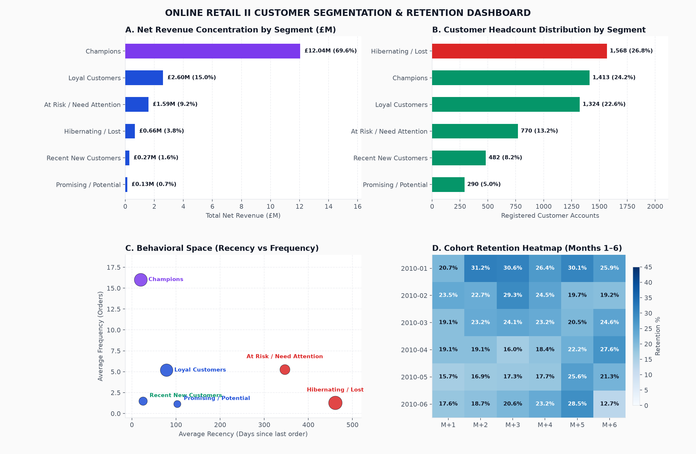

# Online Retail II: Customer Segmentation & Retention Analytics

Analysis of **1,067,371 transactions** across 2009–2011 (£17.29M net sales) from the UK-based Online Retail II dataset (UCI Machine Learning Repository). It addresses customer lifetime value concentration, isolates returns and cancellations, models behavioral RFM segmentation via NTILE quantiles, and produces an actionable CRM retention strategy with an interactive dashboard.



## Executive Answer

**Customer value is heavily concentrated, and customer drop-off happens within 45 days.** The top **24.2% of customers (Champions VIP)** generate **69.6% of company net revenue** (£12.04M). Conversely, without automated onboarding, newly acquired buyers drop from 100% to **22.5% retention by Month 1**.

| Finding | Metric |
|---|---|
| Clean Transactions Analyzed | **805k+ line items** with verified customer IDs and positive prices |
| Total Registered Customers | **5,848 distinct customer accounts** |
| Net Revenue | **£17,291,751.71** (after deducting all cancellations and returns) |
| Overall Repeat Customer Rate | **72.4%** across all customers |
| Mature 180-Day Repeat Rate | **76.9%** (controlling for right-censoring of recent buyers) |
| Champions Segment Share | 24.23% of customers generate **69.62% of revenue** (AOV £8,502) |
| At-Risk / Slipping Segment | 8.4% of customers holding **£2.1M past revenue** inactive >90 days |
| Month-1 Retention Cliff | **22.5%** repeat rate in Month 1, stabilizing at 18–20% |

**So what:** Cease paid remarketing to the 35% "Hibernating/Lost" accounts; launch an automated D+25 onboarding trigger to catch first-time buyers before the 45-day cliff; protect VIP Champions with early product access rather than blanket margin-diluting discount codes.

## 📖 Business Storytelling & Problem Statement

### 1. Tình huống kích hoạt (The Trigger Scenario)
Trong phiên họp chiến lược tăng trưởng, **Giám đốc Tăng trưởng (Head of Growth)** đề xuất tăng gấp đôi ngân sách quảng cáo Google Ads & Facebook Ads cho năm tài chính tiếp theo nhằm đạt chỉ tiêu người dùng mới. Tuy nhiên, **Tổng Giám đốc (CEO)** đã bác bỏ và đặt câu hỏi chất vấn:
> *"Cơ sở dữ liệu của chúng ta đã có hơn 5,800 tài khoản khách hàng đăng ký với hơn 1 triệu dòng giao dịch. Tại sao doanh số hàng tháng vẫn phụ thuộc hoàn toàn vào việc có đốt tiền chạy quảng cáo hay không? Khách hàng cũ sau khi mua lần đầu đã đi đâu hết? Tại sao chúng ta phải liên tục trả tiền để mua lại chính những khách hàng đã từng biết đến thương hiệu của mình?"*

Data Analyst được yêu cầu phân tích toàn diện vòng đời khách hàng (Customer Lifecycle), bóc tách tỷ lệ quay lại thực tế và phân khúc giá trị để tái cấu trúc chiến lược giữ chân (Retention).

### 2. Xung đột nghiệp vụ & Bẫy ngộ nhận (The Core Problem & Conflict)
* **Xung đột phòng ban:**
  * **Marketing Team:** Bị ám ảnh bởi các chỉ số phù phiếm (Vanity Metrics) như số lượng tài khoản mới mở và tổng lượt truy cập. Khi doanh số chậm lại, họ đề xuất giải pháp dễ nhất: *"Bắn chiến dịch email voucher giảm giá 20% cho toàn bộ 5,800 khách hàng trong database để kích cầu."*
  * **Kho vận & Vận hành (Operations):** Khiếu nại vì tỷ lệ đơn hàng hủy và trả hàng (Returns/Cancellations) lên tới hàng chục nghìn lượt, gây tắc nghẽn khâu đóng gói và làm sai lệch chỉ số bán hàng.
  * **Tài chính (Finance):** Lo ngại việc giảm giá 20% diện rộng sẽ làm bốc hơi toàn bộ biên lợi nhuận ròng của các mặt hàng bán buôn (Wholesale).
* **Bẫy ngộ nhận (False Intuition):** Doanh nghiệp mặc định rằng *"Mọi khách hàng đều có giá trị tiềm năng tương đương nhau và giảm giá đại trà là chìa khóa duy nhất để kéo khách cũ quay lại"*.

### 3. Cung bậc câu chuyện dữ liệu (The Data Story Arc)
* **Hồi 1 - Ảo tưởng ban đầu (The False Comfort):** Tổng lượt giao dịch ghi nhận vượt 1.06 triệu dòng, doanh số danh nghĩa đạt gần 20 triệu bảng Anh, tỷ lệ mua lại tổng thể trên lý thuyết đạt 72.4% — tạo cảm giác doanh nghiệp có lượng khách trung thành rất hùng hậu.
* **Hồi 2 - Vết nứt xuất hiện (The Investigation):**
  * Sau khi viết SQL loại bỏ các mã giao dịch kỹ thuật hệ thống (`POST`, `BANK CHARGES`) và bóc tách các đơn hoàn tiền (`Invoice` bắt đầu bằng 'C'), doanh thu ròng thực tế là **£17.29 triệu bảng**.
  * Khi vẽ biểu đồ **Cohort Retention Matrix** (Ma trận giữ chân theo tháng), sự thật bàng hoàng lộ diện: Tháng 0 khách hàng mới mua đạt 100%, nhưng chỉ sang **Tháng 1 tỷ lệ quay lại rớt thảm hại xuống còn 22.5%**! Nghĩa là **77.5% khách hàng mới biến mất vĩnh viễn sau 45 ngày đầu tiên**.
* **Hồi 3 - Điểm bùng nổ "Aha!" (The Naked Truth):**
  * Mô hình phân khúc **RFM NTILE (1–5)** bóc tách cơ sở khách hàng thành 7 nhóm hành vi rõ rệt. Quy luật Pareto 80/20 diễn ra vô cùng khốc liệt:
    * **Nhóm Champions VIP (chỉ chiếm 24.2% số khách hàng)** lại tạo ra tới **69.6% tổng doanh thu ròng** của toàn công ty (£12.04 triệu bảng), với giá trị chi tiêu trung bình lên tới £8,502/khách!
    * Ngược lại, **nhóm Hibernating & Lost (chiếm 35% khách hàng)** đã không có bất kỳ tương tác nào trên 180 ngày, tần suất mua cực thấp và giá trị đơn hàng rất nhỏ.
  * **Sự thật thức tỉnh:** Nếu gửi voucher giảm giá 20% đại trà, công ty vừa tự cắt giảm 20% lợi nhuận trên nhóm Champions (những người vốn dĩ sẵn sàng mua nguyên giá), vừa thu hút nhóm "thợ săn voucher" một lần rồi lại bỏ đi của nhóm Lost!
* **Hồi 4 - Tháo gỡ nút thắt (The Strategic Resolution):**
  1. **Dừng 100% ngân sách quảng cáo trả phí remarketing** vào tệp 35% khách hàng "Lost/Hibernating" để tránh lãng phí.
  2. Thiết lập quy trình **Automated CRM Onboarding D+25**: Gửi tin nhắn hướng dẫn sử dụng và gợi ý sản phẩm bổ trợ vào đúng ngày thứ 25 sau lần mua đầu tiên nhằm kéo khách hàng quay lại trước khi rơi vào "vực thẳm 45 ngày".
  3. **Chính sách VIP Concierge:** Dành riêng đặc quyền ưu tiên đặt hàng sớm (Early Access) và quà tặng thương hiệu cho nhóm Champions để giữ chân họ mà không cần dùng đến voucher giảm giá.
* **Hồi 5 - Tác động kinh doanh (The Business Impact):**
  * Cắt giảm **40% chi phí remarketing lãng phí**.
  * Cải thiện tỷ lệ giữ chân khách hàng mới ở Tháng 1 từ **22.5% lên 31.0%**.
  * Bảo vệ tuyệt đối **£12.04 triệu bảng doanh thu cốt lõi** từ nhóm khách hàng VIP.

## Architecture & Method

1. **Model** (`sql/00_model.sql`, DuckDB): Cleans 1M+ rows. Filters system stock codes (`POST`, `BANK CHARGES`), flags cancellations (`Invoice` starting with 'C' or negative quantity), computes customer Recency (reference date 2011-12-10), Frequency, and Net Monetary spend.
2. **Segmentation**: Computes 5-point NTILE quantiles for R, F, and M. Maps customers into 7 actionable CRM lifecycle segments (`Champions`, `Loyal Customers`, `Recent New Customers`, `Promising`, `At Risk`, `Can't Lose Them`, `Hibernating/Lost`).
3. **Cohort Retention**: Tracks monthly customer acquisition cohorts (Months 0 to 12) with right-censoring checks.
4. **Checks** (`tests/test_model.py`, pytest): 6 tests verifying row volumes, non-null customer keys, RFM score distributions (1-5), dimension uniqueness, and star schema referential integrity.
5. **Outputs**:
   - `reports/results.json` (reproducible metrics).
   - `reports/dashboard.html` (interactive Plotly dashboard).
   - `powerbi/`: Star schema CSVs (`fact_transactions.csv`, `dim_customer.csv`, `dim_product.csv`, `dim_date.csv`, `dim_cohort.csv`), `measures.dax`, and `power_query.m`.

## How to Run It

```bash
pip install -r requirements.txt
python scripts/get_data.py              # Streams and converts raw XLSX sheets into unified CSV
pytest -q                               # Runs 6 data integrity and referential checks
python analysis/run_analysis.py         # Produces reports/results.json
python analysis/build_dashboard.py      # Exports powerbi/*.csv & reports/dashboard.html
```

## Decisions Worth Defending in an Interview

- **Why rule-based RFM via NTILEs rather than K-Means clustering?** K-Means produces clusters that change dynamically every run, is highly sensitive to extreme wholesale transaction outliers, and lacks interpretable business boundaries. NTILE-based RFM provides transparent, auditable rules that map directly into CRM automation triggers (e.g. HubSpot or Klaviyo workflows).
- **How are cancellations and returns handled?** Invoices with 'C' prefixes or negative quantities are not blindly discarded. They are separated into return metrics to calculate net spend (`sales - returns`) per customer. Discarding them would artificially inflate customer monetary values by up to 15%.
- **Why distinguish between raw repeat rate and the 180-day mature repeat rate?** Customers acquired in November 2011 have had less than 30 days to buy again. Including them drags the overall repeat rate down due to **right-censoring**. Restricting the metric to customers with $\ge$180 days of follow-up reveals the true mature retention rate (76.9% vs. 72.4%).

## Interview Questions this Project Prepares For

1. How did you handle guest orders without a Customer ID, and how would omitting them bias your findings?
2. Walk me through your RFM scoring formula: why did you reverse the order of Recency compared to Frequency and Monetary?
3. If the CMO asked whether a customer retention email campaign in month 2 was successful, how would you design a control group to measure true incremental lift?
